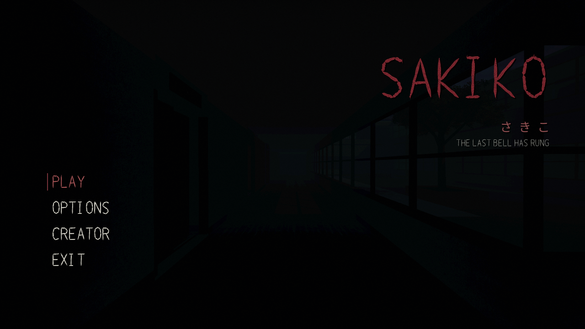
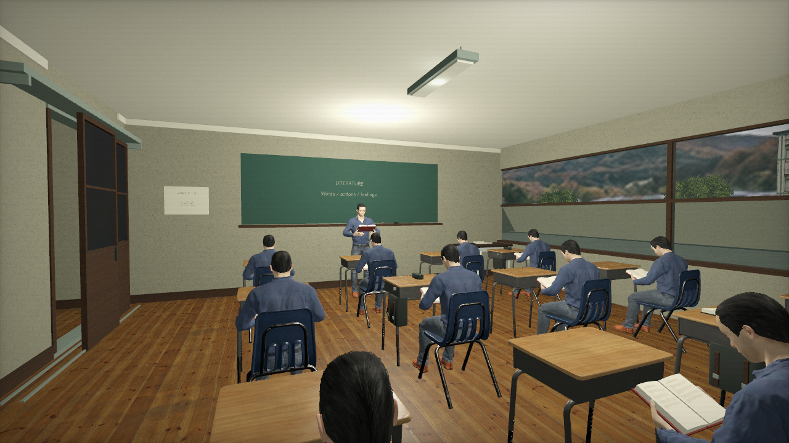
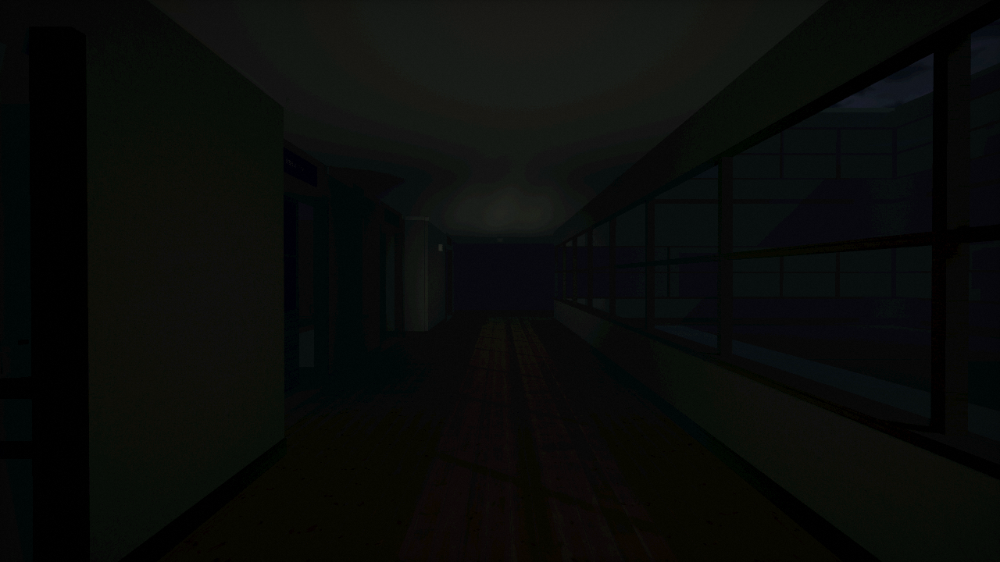

# SAKIKO / さきこ

*The last bell has rung.*

A first-person horror game by **medissl**. Wake in a Japanese school after dark, explore its empty halls, piece together the evidence, and find a way out.

## Download and play

**[Download SAKIKO for Windows x64](https://github.com/medissl/SAKIKO/releases/latest/download/SAKIKO-Windows-x64.zip)** · [All releases](https://github.com/medissl/SAKIKO/releases) · [SHA256 checksum](https://github.com/medissl/SAKIKO/releases/latest/download/SAKIKO-Windows-x64.zip.sha256)

1. Download the Windows ZIP above.
2. Extract the entire archive.
3. Open `SAKIKO.exe` inside the `SAKIKO` folder.

No Godot installation is required. This build needs 64-bit Windows and a Vulkan-capable graphics driver. Volume, subtitles, sensitivity, reduced effects, and anti-aliasing can be adjusted in **Options**.

## Screenshots

Actual in-game captures, with encounters and story reveals kept out of the gallery.

*Before the last bell.*

*After everyone has gone.*

## Controls

| Input | Action |
| --- | --- |
| Mouse / WASD | Look / move |
| Shift | Sprint |
| E | Interact |
| F | Flashlight |
| J | Evidence journal |
| Escape | Pause / close inspection |
| Drag / mouse wheel | Tilt / zoom inspected objects |
| E, Space, or Escape during the lesson | Skip to the waking transition |

Collected entrance keys create checkpoints for the current run. Returning to a checkpoint retains evidence and puzzle progress; restarting clears the run. Checkpoints do not persist after closing the game.

## Run from source

Import `project.godot` in **Godot 4.7.2**, let the bundled assets import, and press **F5**. The project uses the Mobile renderer with Vulkan. Runtime assets are local; no account or network connection is required to play.

The Windows build embeds its game data in the executable. Binary downloads belong in [Releases](https://github.com/medissl/SAKIKO/releases), rather than the source tree. Export packaging and verification details are in [the playtest record](docs/PLAYTEST_POLISH_2026-10-16.md).

## Credits and license

Game by **medissl**. Copyright © 2026 medissl. All rights reserved.

SAKIKO is proprietary; publishing its source here does not grant an open-source license. Original owned material is governed by [LICENSE.txt](LICENSE.txt). Third-party assets retain their own terms; see [third-party notices](THIRD_PARTY_NOTICES.md), [asset credits](ASSET_SOURCES.md), and [engine notices](licenses/GODOT_ENGINE_LICENSE.txt).

Authorized Windows downloads include the required license and attribution documents.
